<div align="center">

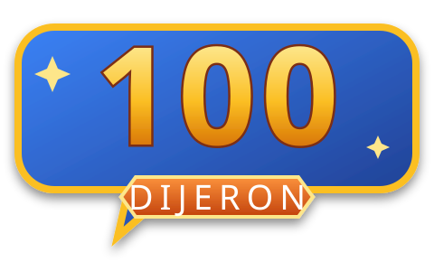

# 100 Dijeron

### El concurso de «¿qué respondió la gente?» para animar reuniones virtuales

Juego estilo concurso de televisión para jugar en **Google Meet** con dos equipos, una pantalla para el público y un panel privado para los presentadores. Se alimenta de las respuestas reales de una encuesta interna.

[](https://github.com/JohannBulls/100-Dijo/actions/workflows/pruebas.yml)


[](LICENSE)

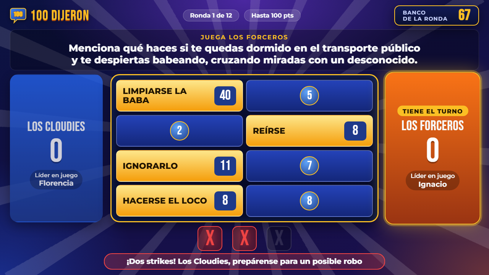

[Características](#-características) · [Capturas](#-capturas) · [Inicio rápido](#-inicio-rápido) · [Cómo se juega](#-cómo-se-juega) · [Documentación](#-documentación)

</div>

---

## ✨ Características

| | |
|---|---|
| 📺 **Dos pantallas sincronizadas** | Una pantalla pública para compartir en Meet y un panel privado con todas las respuestas y botones. Se actualizan al instante. |
| 🧩 **Preparación guiada** | Registro de participantes (uno por uno o pegando una lista), validaciones claras y vista previa de las rondas. |
| 🎲 **Sorteos reales y animados** | Reparto equitativo de equipos, orden aleatorio de preguntas y **ruleta de líderes** sin repeticiones dentro de cada ciclo. |
| 🧮 **100 puntos por pregunta** | Cada tablero reparte exactamente 100 puntos según cuántas personas dieron cada respuesta. |
| ⭐ **Rondas extra** | Rondas adicionales configurables con multiplicador (×2 = hasta 200 puntos). |
| ⚔️ **Cara a cara con reglas claras** | Turno para quien levantó la mano primero, la respuesta n.º 1 gana de inmediato, el rival debe superar la referencia, 2 intentos por líder y cambio de líderes si ninguno acierta. También se puede omitir. |
| ❌ **Reglas del concurso** | Jugar o pasar, strikes con X gigantes, robo de puntos, tablero completo y corrección del ganador. |
| 📋 **Preguntas revisadas** | Cada pregunta habilitada tiene de 4 a 10 respuestas reales. El panel muestra ejemplos de respuestas aceptadas y un criterio para aceptar variantes. |
| 🔊 **Sonido de estudio de TV** | Efectos y música **originales**, generados por el navegador (sin audio con derechos de autor), con control de volumen. |
| ↩️ **A prueba de errores** | Deshacer ilimitado, protección contra doble clic, cancelar ronda y partida guardada automáticamente. |
| 🔒 **Privado por diseño** | La pantalla pública nunca recibe respuestas ocultas. El servidor solo acepta conexiones desde el propio computador. |

## 📸 Capturas

| Sorteo de equipos | Ruleta de líderes |
|:---:|:---:|
| 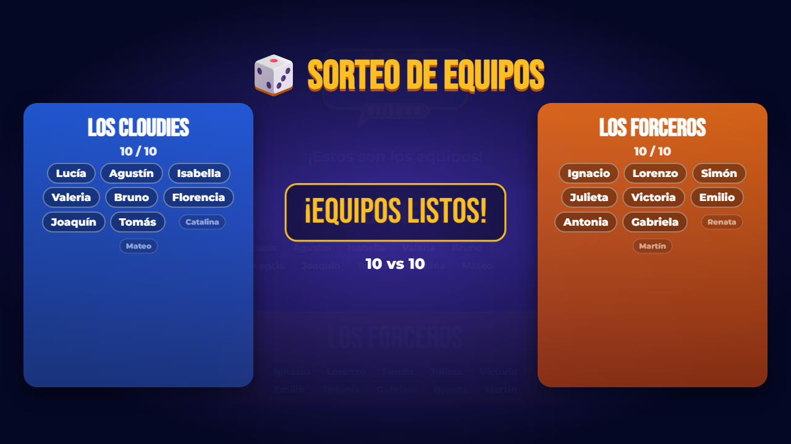 | 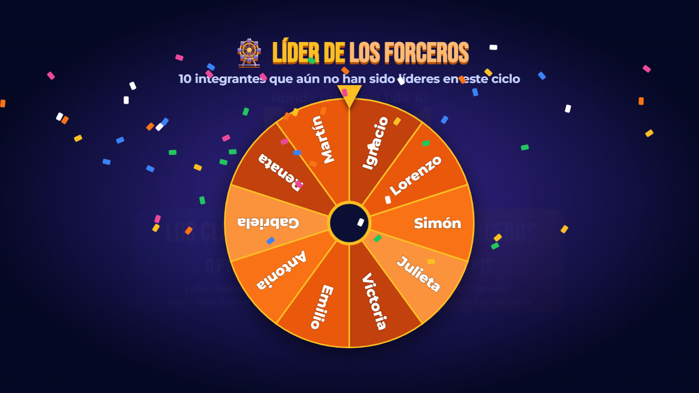 |
| **Cara a cara: hay que superar la referencia** | **Ganador del cara a cara** |
| 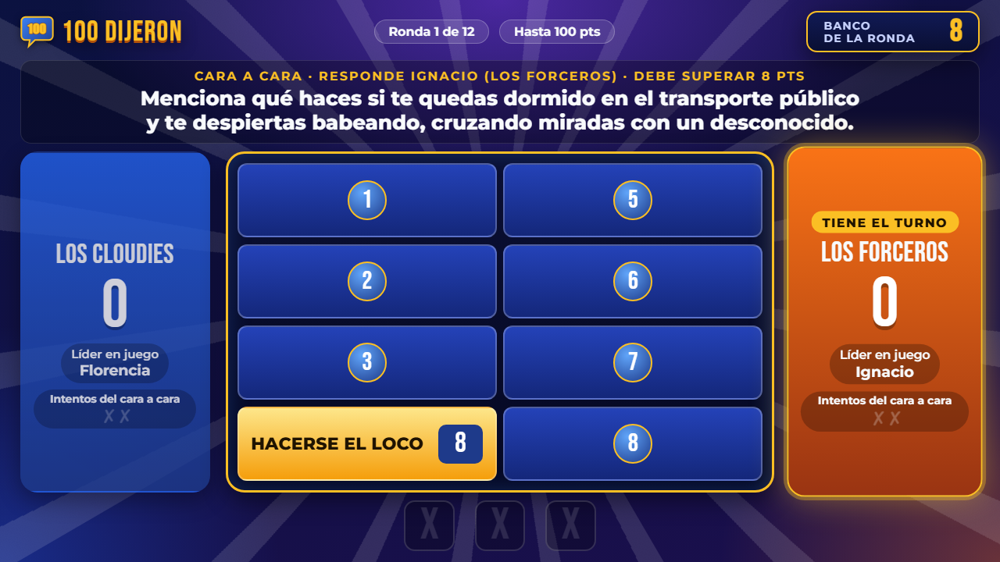 | 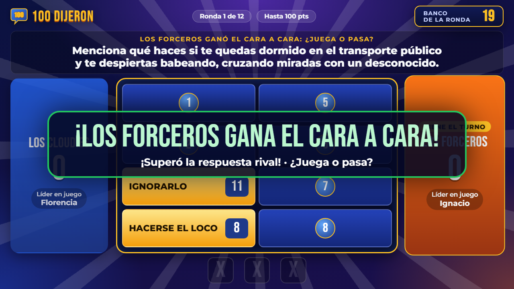 |
| **Ronda extra ×2** | **Robo exitoso** |
|  | 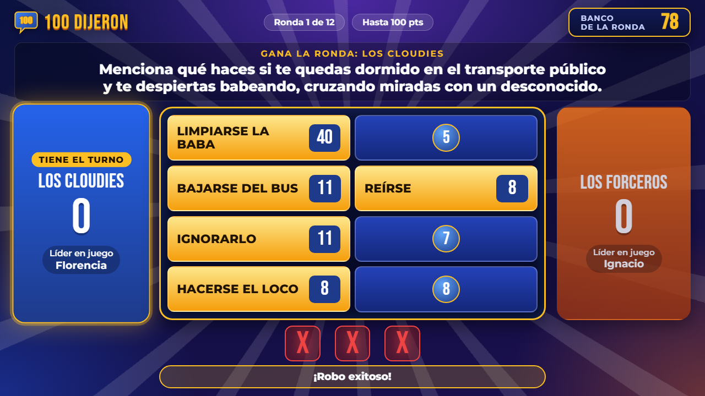 |
| **Equipo ganador** | **Portada** |
| 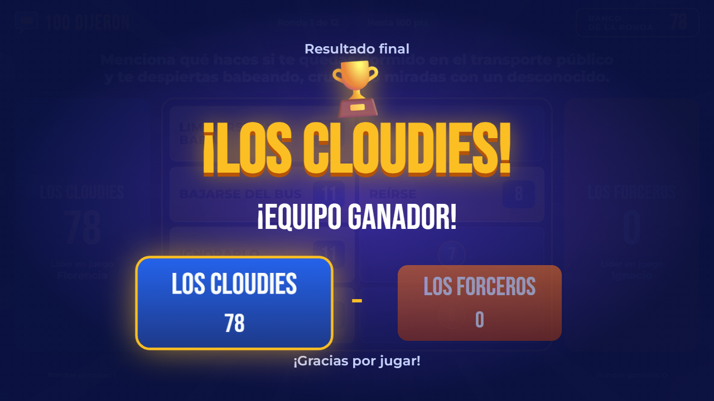 | 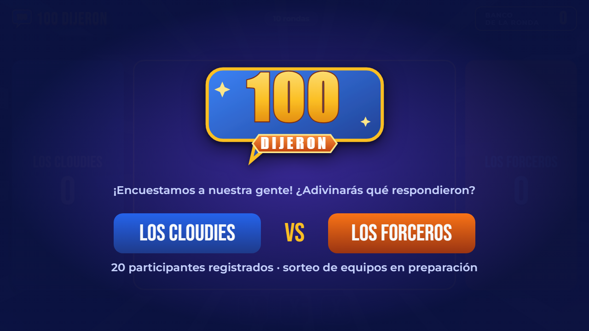 |

<details>
<summary><b>🔒 Panel privado del presentador</b> (clic para ver)</summary>

<br>

| Preparación de la partida | Cara a cara | Control de la ronda |
|:---:|:---:|:---:|
| 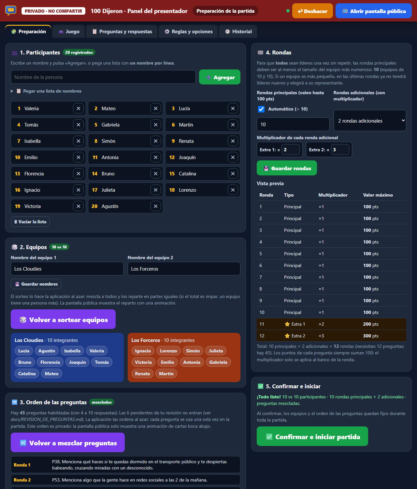 | 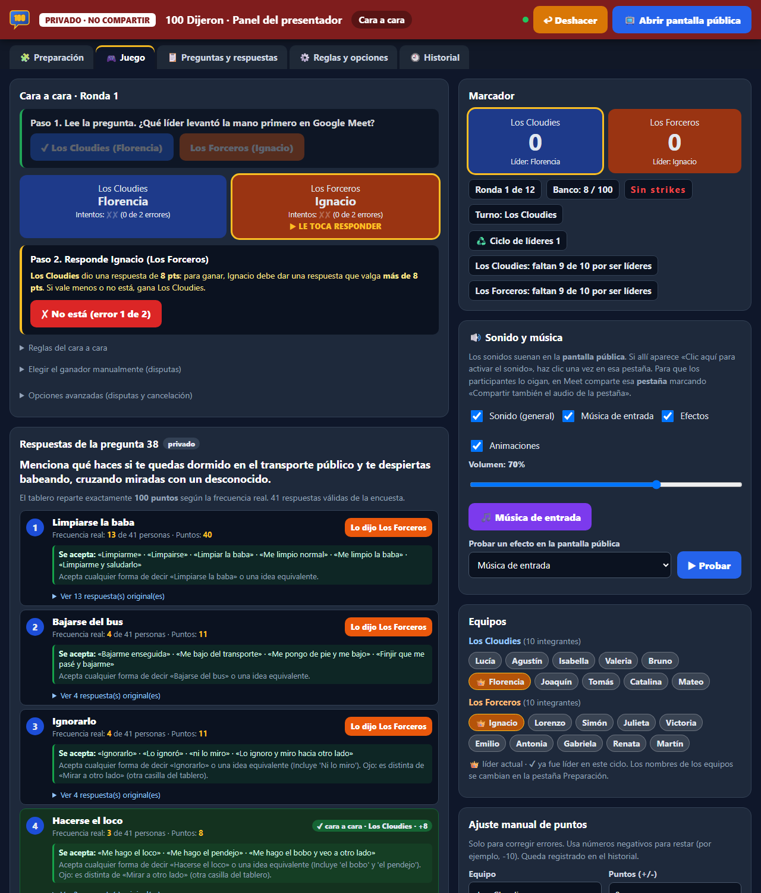 | 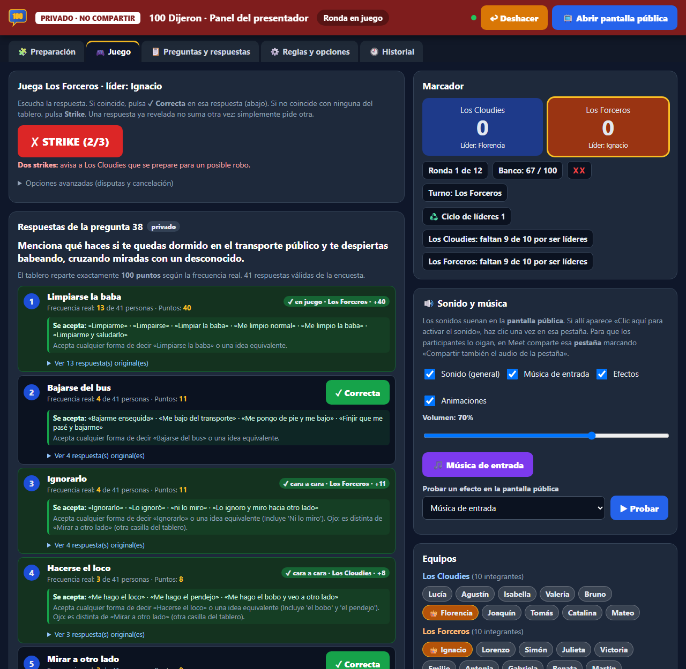 |

</details>

> Las capturas usan una partida de demostración con nombres inventados.

## 🚀 Inicio rápido

**Requisito:** Windows con [Python 3.12 o superior](https://www.python.org/downloads/). Al instalarlo, marca *Add python.exe to PATH*.

1. **Descarga** el proyecto (botón verde **Code → Download ZIP**, o `git clone https://github.com/JohannBulls/100-Dijo.git`).
2. **Haz doble clic en `INICIAR_JUEGO.bat`**. La primera vez prepara el entorno solo (necesita internet esa única vez). Luego se abre el navegador.
3. Abre el **🔒 Panel del presentador** y, desde ahí, la **📺 Pantalla pública**.
4. En Google Meet, comparte **la pestaña** de la pantalla pública y marca **«Compartir también el audio de la pestaña»**.

**Para detener el juego:** cierra la ventana negra del servidor. La partida queda guardada y continúa al volver a abrirlo.

<details>
<summary><b>⌨️ Comandos equivalentes (para usuarios avanzados)</b></summary>

```bat
:: Desde la carpeta del proyecto
.venv\Scripts\python.exe app\servidor.py                      :: iniciar el juego
.venv\Scripts\python.exe -m unittest discover -s pruebas -v   :: ejecutar las pruebas
.venv\Scripts\python.exe app\procesar_excel.py                :: volver a procesar el Excel
```

| Archivo | Para qué sirve |
|---|---|
| `INICIAR_JUEGO.bat` | Inicia el juego (servidor + navegador). |
| `EJECUTAR_PRUEBAS.bat` | Ejecuta las pruebas automáticas e indica qué Python usó. |
| `PROCESAR_EXCEL.bat` | Regenera `datos/` a partir del Excel de la encuesta. |

</details>

## 🎮 Cómo se juega

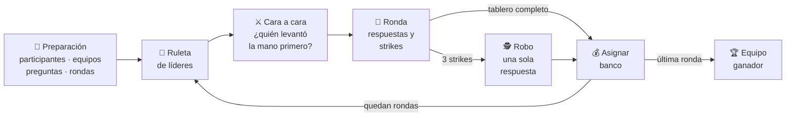

1. **Preparación:** registra a los participantes, sortea los equipos, mezcla las preguntas y elige cuántas rondas extra jugar.
2. **Ruleta de líderes:** antes de cada ronda se elige al azar un líder por equipo, sin repetir hasta que todos lo hayan sido.
3. **Cara a cara:** responde primero el líder que levantó la mano en Meet. La respuesta n.º 1 gana de inmediato; si no, el otro líder debe superarla en puntos. Cada líder tiene 2 intentos. El ganador decide si su equipo juega o pasa. Ver **[reglas del cara a cara](docs/REGLAS_CARA_A_CARA.md)**.
4. **Ronda:** el equipo intenta descubrir todo el tablero. Cada respuesta que no está suma un strike.
5. **Robo:** con tres strikes, el rival tiene **una** respuesta para robar todo el banco.
6. **Final:** gana el equipo con más puntos.

La guía completa, paso a paso, está en **[docs/GUIA_DE_USUARIO.md](docs/GUIA_DE_USUARIO.md)**, y hay un guion listo para los dos presentadores en **[docs/GUION_PRESENTADORES.md](docs/GUION_PRESENTADORES.md)**.

## 🧮 Puntuación

Cada pregunta reparte **exactamente 100 puntos** entre las respuestas de su tablero, en proporción a cuántas personas dieron cada una:

| Pregunta 15: «Electrodoméstico que no puede faltar en la cocina» | Personas | Puntos |
|---|---:|---:|
| Nevera | 17 | **45** |
| Licuadora | 9 | **24** |
| Estufa | 7 | **18** |
| Cafetera | 3 | **8** |
| Horno | 2 | **5** |
| **Total** | 38 | **100** |

- **Garantías:** los puntos son enteros, la respuesta más popular siempre vale más y los empates conservan los mismos puntos.
- **Rondas extra:** multiplican el banco (×2, ×3…) sin cambiar los puntos base.

El detalle del cálculo está en [docs/ARQUITECTURA.md](docs/ARQUITECTURA.md#puntuación).

## 🗂️ Estructura del proyecto

```text
100-Dijo/
├── INICIAR_JUEGO.bat          ▶ iniciar el juego (doble clic)
├── EJECUTAR_PRUEBAS.bat       ▶ ejecutar las pruebas
├── PROCESAR_EXCEL.bat         ▶ volver a procesar la encuesta
├── app/
│   ├── servidor.py            servidor HTTP local y API JSON
│   ├── juego.py               motor del juego (máquina de estados, sorteos, puntos)
│   ├── procesar_excel.py      encuesta → preguntas con tableros de 100 puntos
│   └── web/
│       ├── inicio.html · publico.html · presentador.html
│       ├── css/estilos.css
│       ├── img/               logo e icono de 100 Dijeron (originales)
│       └── js/                publico · presentador · espectaculos (animaciones) · sonidos
├── datos/                     preguntas procesadas (sin nombres de participantes)
├── docs/                      guía, guion, arquitectura, decisiones e imágenes
├── pruebas/                   pruebas automáticas (unittest)
├── scripts/                   preparación del entorno de Python (.venv)
└── .github/workflows/         pruebas automáticas en GitHub Actions
```

## 🏗️ Arquitectura

- **Servidor y estado:** un servidor Python local guarda el estado de la partida y lo sirve a dos páginas web.
- **Panel del presentador:** envía acciones al servidor (`POST /api/accion`).
- **Pantalla pública:** recibe una vista filtrada, sin respuestas ocultas.
- **Sorteos:** los hace el servidor con el azar del sistema operativo. Las animaciones solo muestran el resultado guardado.
- **Sin infraestructura externa:** no hay base de datos, cuentas ni servicios externos.

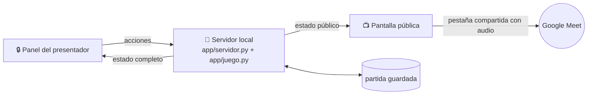

Más detalles, como la máquina de estados, la API, los ciclos de líderes y la sincronización, en **[docs/ARQUITECTURA.md](docs/ARQUITECTURA.md)**.

## 🧪 Pruebas

```bat
EJECUTAR_PRUEBAS.bat
```

Hay **114 pruebas automáticas** que cubren lo siguiente:
- El procesamiento de la encuesta y el reparto de 100 puntos.
- Los sorteos: equidad, uniformidad y fidelidad de las animaciones.
- Los ciclos de líderes y las rondas extra.
- Las reglas del cara a cara: turnos, referencia, empates, 2 intentos, cambio de líderes y omitirlo.
- Los strikes, el robo, el deshacer y el doble clic.
- Los datos publicados: 4 a 10 respuestas por pregunta, ejemplos reales y la identidad «100 Dijeron».
- La privacidad de la pantalla pública.
- La recuperación de la partida y el servidor HTTP de punta a punta.

En GitHub se ejecutan solas en cada cambio (Windows y Linux, Python 3.12 y 3.14). Ahí no están el Excel original ni los datos privados, así que las pruebas que los necesitan se omiten con un aviso. Detalle en [docs/PRUEBAS.md](docs/PRUEBAS.md).

## 🔒 Privacidad y datos

- **El Excel original no se publica.** Contiene los nombres de quienes respondieron junto a sus respuestas y está excluido en [`.gitignore`](.gitignore).
- **`datos/` no tiene nombres de personas.** Cada respuesta se identifica solo por su número de fila; ver [datos/README.md](datos/README.md).
- **Personas mencionadas en las respuestas:** si una respuesta nombra a alguien, en los datos publicados aparece como «[nombre]». La lista de nombres a ocultar está en `datos/privado/`, que tampoco se publica.
- **Contenido sensible:** se conservan el humor y las groserías de la encuesta. Unas pocas respuestas discriminatorias quedan fuera del tablero hasta revisarlas; ver [docs/DECISIONES_PARA_REVISAR.md](docs/DECISIONES_PARA_REVISAR.md).

## 📚 Documentación

| Documento | Para quién |
|---|---|
| [Guía de usuario](docs/GUIA_DE_USUARIO.md) | Organizadores y presentadores: cómo preparar y dirigir la partida en Meet. |
| [Guion de presentadores](docs/GUION_PRESENTADORES.md) | Textos sugeridos para la apertura, la ruleta, los strikes, el robo y el cierre. |
| [Reglas del cara a cara](docs/REGLAS_CARA_A_CARA.md) | Quién responde, quién gana, empates, los 2 intentos, el cambio de líderes y cómo omitirlo. |
| [Revisión de preguntas](docs/REVISION_DE_PREGUNTAS.md) | Reporte de jugabilidad: preguntas listas, mejoradas y pendientes de tu aprobación (se genera solo). |
| [Preguntas pendientes](docs/PREGUNTAS_PENDIENTES.md) | Cómo aprobar o corregir una pregunta que tiene menos de 4 respuestas. |
| [Decisiones para revisar](docs/DECISIONES_PARA_REVISAR.md) | Reglas, agrupaciones dudosas y tratamiento de contenido. |
| [Diccionario de datos](docs/DICCIONARIO_DE_DATOS.md) | Hojas y columnas del Excel consolidado y campos del JSON. |
| [Pruebas](docs/PRUEBAS.md) | Qué verifica cada grupo de pruebas y cómo ejecutarlas. |
| [Arquitectura](docs/ARQUITECTURA.md) | Desarrolladores: diseño, API, máquina de estados y pruebas. |
| [Datos](datos/README.md) | Qué contiene cada archivo de datos y cómo corregir una agrupación. |
| [Historial de cambios](CHANGELOG.md) | Qué cambió en cada versión. |

<details>
<summary><b>🛠️ Solución de problemas</b></summary>

| Problema | Solución |
|---|---|
| «No se encontró Python» | Instala Python 3.12+ marcando *Add python.exe to PATH*. |
| `ModuleNotFoundError: openpyxl` | Usa `EJECUTAR_PRUEBAS.bat` o el Python de `.venv`, no otro intérprete del sistema. |
| «El puerto 8765 ya está en uso» | El juego ya está abierto en otra ventana negra: usa esa. |
| La pantalla pública dice «Sin conexión con el juego» | Se cerró la ventana negra. Vuelve a abrir `INICIAR_JUEGO.bat`; la partida sigue donde estaba. |
| No suena nada | Haz un clic en la pantalla pública («Activar sonido») y revisa la tarjeta **Sonido y música** del panel. |
| Yo oigo los sonidos, pero los participantes no | En Meet comparte **la pestaña** (no la ventana) y marca «Compartir también el audio de la pestaña». |

</details>

## 📄 Licencia

El código y la documentación se distribuyen bajo la **[licencia MIT](LICENSE)**.

Las respuestas de la encuesta en `datos/` son contenido interno de la organización. Se incluyen solo para poder ejecutar el juego.

El logo y el icono de **100 Dijeron** son originales de este proyecto (licencia MIT).

Proyecto independiente, inspirado en el formato de los concursos de televisión del tipo «¿qué dijo la gente?». **No está afiliado** a ningún programa de televisión ni usa sus marcas, logotipos ni audio.

## 👤 Autor

**Johann Amaya** · [@JohannBulls](https://github.com/JohannBulls)
