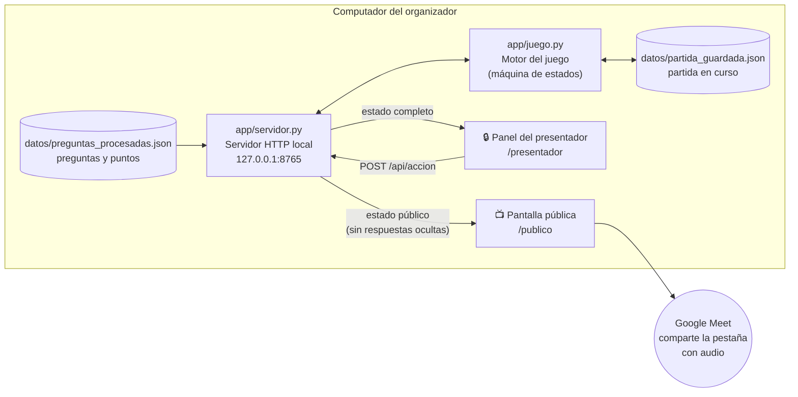
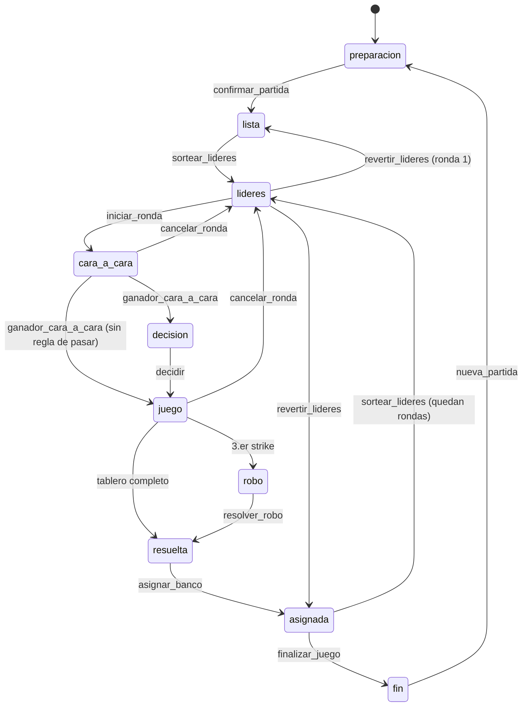
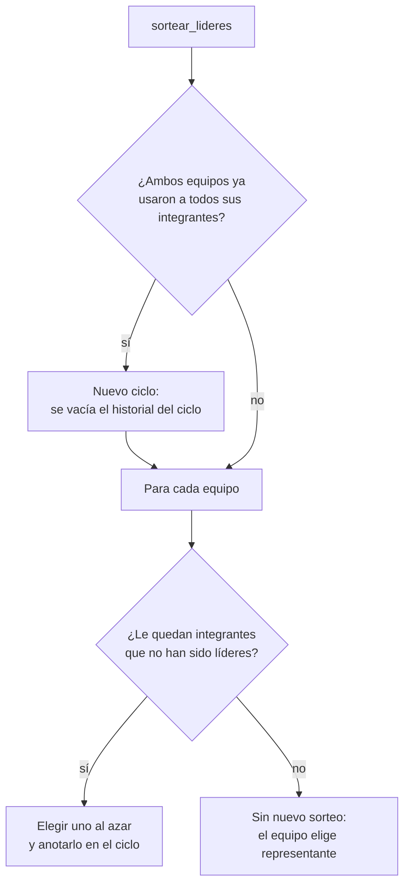

# Arquitectura técnica

Documento para quien quiera entender o modificar el código. Si solo vas a dirigir el juego, lee la [Guía de usuario](GUIA_DE_USUARIO.md).

## Visión general

El juego es una aplicación web **local**: un pequeño servidor en Python (solo biblioteca estándar) guarda el estado de la partida, y dos páginas del navegador lo muestran:



- **No hay base de datos ni servicios externos.** Todo el estado vive en memoria y se guarda en un archivo JSON después de cada acción.
- **El servidor solo escucha en `127.0.0.1`.** Ningún otro equipo de la red puede conectarse.
- **La pantalla pública nunca recibe información privada.** El servidor le envía una vista filtrada (`Juego.vista_publica()`), sin respuestas ocultas, frecuencias, respuestas originales ni el orden de las preguntas.

## Estructura del código

| Ruta | Responsabilidad |
|---|---|
| `app/procesar_excel.py` | Lee el Excel de la encuesta y `datos/agrupaciones.json`, fija el tablero de cada pregunta y reparte los 100 puntos. Escribe `datos/preguntas_procesadas.json` y `.xlsx`. |
| `app/juego.py` | Motor del juego: preparación, sorteos, ciclos de líderes, rondas, puntuación, deshacer y vistas pública y privada. No depende de la red ni del navegador. |
| `app/servidor.py` | Servidor HTTP: páginas estáticas, API JSON, guardado atómico y «espera larga». |
| `app/web/*.html` | Inicio, pantalla pública y panel del presentador. |
| `app/web/js/publico.js` | Pantalla pública: sincronización, tablero, portadas y animación de eventos. |
| `app/web/js/espectaculos.js` | Animaciones largas: sorteo de equipos, mezcla de preguntas, ruleta de líderes y ronda extra. |
| `app/web/js/sonidos.js` | Efectos y música sintetizados con Web Audio (sin archivos de audio). |
| `app/web/js/presentador.js` | Panel privado: pestañas, formularios y envío de acciones. |
| `app/web/css/estilos.css` | Estilos de las tres páginas (tokens de color, tablero, ruletas y panel). |
| `scripts/preparar_entorno.bat` | Crea `.venv` e instala `requirements.txt` (lo usan los tres `.bat`). |
| `pruebas/` | Pruebas automáticas (`unittest`). |

## Ciclo de una partida (máquina de estados)

Cada acción se valida contra la fase actual; si no corresponde, se rechaza con un mensaje claro.



## Acciones (`POST /api/accion`)

El cuerpo es `{"version": N, "accion": {"tipo": "...", ...}}`. `version` es la versión del estado que tenía la pantalla al pulsar el botón: si ya cambió (por ejemplo, por un doble clic), la acción se rechaza con el código 409 y no se aplica dos veces.

| Grupo | Acciones |
|---|---|
| Preparación | `agregar_participantes`, `editar_participante`, `eliminar_participante`, `vaciar_participantes`, `sortear_equipos`, `mezclar_preguntas`, `configurar_partida`, `confirmar_partida`, `reiniciar_configuracion` / `nueva_partida` |
| Líderes | `sortear_lideres`, `revertir_lideres` |
| Ronda | `iniciar_ronda`, `primero_en_responder`, `respuesta_cara_a_cara`, `ganador_cara_a_cara`, `decidir`, `revelar`, `strike`, `resolver_robo`, `revelar_restantes`, `asignar_banco`, `cerrar_ronda`, `cancelar_ronda` |
| Partida | `finalizar_juego`, `ajustar_puntaje`, `reiniciar_marcador`, `deshacer` |
| Configuración y audio | `configurar`, `musica`, `probar_sonido` |

Cada acción deshacible guarda una copia del estado anterior; `deshacer` la restaura. Se conservan las últimas 150.

## Azar y fidelidad de las animaciones

- **El servidor hace todos los sorteos** con `random.SystemRandom()`, el azar del sistema operativo. Las pruebas usan un generador con semilla para que los resultados sean reproducibles.
- **Equipos:** se baraja a todos y se asignan alternando equipos (el que empieza también es al azar). Resultado: equipos iguales, o con una persona de diferencia si el total es impar.
- **Líderes:** se elige al azar entre quienes aún no han sido líderes en el ciclo. El evento `sorteo_lideres` lleva la lista de candidatos y el **índice** del elegido.
- **Las animaciones no deciden nada.** La ruleta calcula su ángulo final a partir de ese índice, y el sorteo de equipos reproduce la secuencia guardada. Las pruebas comprueban que el evento coincide con lo guardado, y en el navegador se midió que el puntero apunta al segmento correcto.

## Ciclos de líderes



Las rondas principales mínimas son el tamaño del equipo más numeroso, para que todos sean líderes una vez.

## Puntuación

`procesar_excel.repartir_100()` reparte 100 puntos entre las respuestas del tablero, proporcionalmente a su frecuencia:

1. Cada respuesta recibe la parte entera de `frecuencia × 100 ÷ suma`. Se usa aritmética entera, sin errores de redondeo.
2. Los puntos que faltan se entregan por grupos completos de igual frecuencia, de mayor a menor parte decimal. Así los empates conservan los mismos puntos.
3. Si un grupo empatado no cabe completo, el sobrante va a la respuesta más popular.
4. Se garantiza un mínimo de 1 punto por respuesta.

El motor nunca recalcula puntos: usa `respuesta["puntos"]` del archivo procesado. El multiplicador de las rondas extra se aplica al sumar al banco.

## Sincronización («espera larga»)

Las páginas piden `/api/publico?esperar=N`. El servidor mantiene la petición abierta (con un `threading.Condition`) hasta que la versión cambia, y entonces responde. La página lanza la siguiente petición en cuanto recibe la respuesta.

Este diseño no depende de temporizadores. Así, la pestaña compartida en Meet se actualiza al instante aunque el navegador la tenga en segundo plano y ralentice sus temporizadores.

## Persistencia

Tras cada acción, `Servicio.guardar()` escribe `datos/partida_guardada.json` de forma atómica: primero en un archivo temporal y luego reemplaza el anterior. Se guardan el estado completo y la pila de deshacer.

Al iniciar, el servidor lo vuelve a leer: equipos, orden de preguntas, líderes, puntos, casillas reveladas, strikes y robo siguen igual. Recargar la página nunca reinicia la partida.

## Pruebas

```
.venv\Scripts\python.exe -m unittest discover -s pruebas -v
```

| Archivo | Qué prueba |
|---|---|
| `pruebas/test_juego.py` | Motor: preparación, sorteos (equidad y uniformidad), ciclos de líderes, rondas extra, puntuación, deshacer y vista pública. |
| `pruebas/test_procesamiento_y_servidor.py` | Procesamiento del Excel real (necesita el Excel, que no se publica), reparto de 100 puntos, coherencia Excel ↔ JSON y servidor HTTP de punta a punta. |

En GitHub, el flujo `.github/workflows/pruebas.yml` ejecuta las pruebas en cada cambio. Allí no está el Excel, así que las pruebas de procesamiento se omiten con un aviso.
